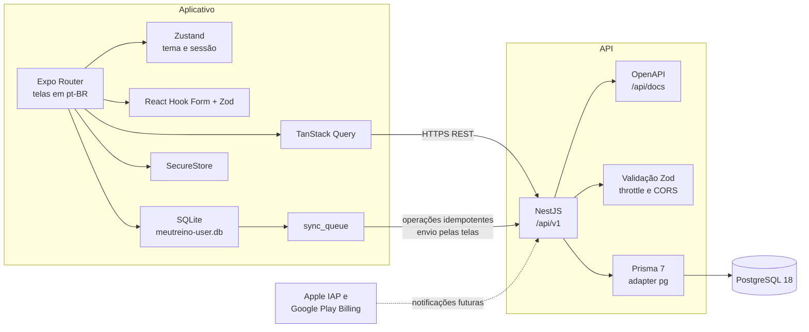

# Arquitetura — MeuTreino+ 0.1

Este documento descreve a fundação técnica da versão 0.1. As regras de produto estão em [PRODUCT_SCOPE.md](./PRODUCT_SCOPE.md). O modelo relacional está em [DATA_MODEL.md](./DATA_MODEL.md).

## Diagrama

O aplicativo é a fonte operacional durante o treino. A API é a fonte de verdade depois da sincronização, com as exceções de conflito descritas em [OFFLINE_SYNC.md](./OFFLINE_SYNC.md).

## Monorepo

| Caminho             | Responsabilidade                                              |
| ------------------- | ------------------------------------------------------------- |
| `apps/mobile`       | Aplicativo Expo para iOS, Android e verificação web           |
| `apps/api`          | API NestJS, schema Prisma e migrações                         |
| `packages/shared`   | Contratos, catálogos, entitlement e política de sincronização |
| `docs`              | Arquitetura e escopo de produto                               |
| `infrastructure`    | Docker Compose do PostgreSQL local                            |
| `scripts`           | Validação local                                               |
| `.github/workflows` | CI no GitHub Actions                                          |

O gerenciador de pacotes é npm workspaces. O Node 24 já está disponível no ambiente de desenvolvimento e o npm 11 gerencia workspaces sem instalar outro gerenciador.

`@meutreino/shared` publica somente funções puras, constantes e schemas Zod. Ele não importa NestJS, Prisma, Expo nem React Native. O aplicativo e a API dependem dele; ele não depende de nenhum dos dois.

## Versões escolhidas

Verificadas no registro npm em 20 de outubro de 2026 e fixadas nos `package.json`.

| Componente      | Versão                               | Motivo                                                                                                                  |
| --------------- | ------------------------------------ | ----------------------------------------------------------------------------------------------------------------------- |
| Node.js         | `>=22.13.0 <25`, validado em 24.13.1 | Mínimo do Expo SDK 58. O aviso do `@angular-devkit` pede Node `^24.15.0`; o CLI do Nest funciona nesta versão           |
| TypeScript      | 6.0.3                                | O 7.0.2 quebra os peers de `typescript-eslint` 8, `@nestjs/swagger` 12 e `ts-jest`                                      |
| ESLint          | 9.39.5                               | `eslint-config-expo` 58 falha no ESLint 10. A linha 9 emite aviso de depreciação do npm e permanece por compatibilidade |
| Prettier        | 3.9.10                               | Formatação única do monorepo                                                                                            |
| NestJS          | 12.2.0                               | Linha estável atual, ESM                                                                                                |
| Prisma          | 7.10.1                               | A tag `latest` apontava para 8.0.0-rc.23. A 7.10.1 é a estável                                                          |
| PostgreSQL      | 18-alpine                            | Imagem oficial. O volume local monta `/var/lib/postgresql`                                                              |
| Expo SDK        | 58.0.16                              | Linha estável atual do `create-expo-app`                                                                                |
| React           | 19.3.0                               | Pin do SDK 58                                                                                                           |
| React Native    | 0.88.0                               | Pin do SDK 58                                                                                                           |
| Zod             | 4.6.7                                | Validação compartilhada                                                                                                 |
| TanStack Query  | 5.104.5                              | Cache remoto no aplicativo                                                                                              |
| Zustand         | 5.0.15                               | Estado de interface                                                                                                     |
| React Hook Form | 7.90.0                               | Formulários futuros                                                                                                     |
| Jest            | 30.5.2                               | Testes da API com `--experimental-vm-modules`                                                                           |
| Vitest          | 5.0.5                                | Testes do pacote compartilhado                                                                                          |

`module` é `commonjs` e `moduleResolution` é `bundler`. O TypeScript 6 descontinua `node10`/`node`. `ignoreDeprecations` não é usado.

## API

- Prefixo global `api/v1`.
- `GET /api/v1/health` consulta o PostgreSQL e devolve o schema compartilhado `healthReportSchema`. Resposta 200 com banco disponível e 503 quando degradado.
- Swagger em `/api/docs` fora de produção.
- Configuração validada por Zod na subida. `DATABASE_URL` precisa ser PostgreSQL. `CORS_ORIGINS` vazio recusa o navegador. `*` e origens fora de `http`, `https` e `exp` são recusadas.
- Throttle em memória: 100 requisições por minuto por instância. O health check fica fora do throttle e do log automático.
- Logs Pino. Cabeçalhos `authorization` e `cookie` e campos de senha e token são redigidos. Erros 500 não devolvem o diagnóstico interno.
- Cabeçalhos: `X-Content-Type-Options: nosniff`, `Referrer-Policy: no-referrer`, `X-Frame-Options: DENY`, `Permissions-Policy` sem câmera, microfone e geolocalização, `Cache-Control: no-store`. `x-powered-by` desligado.
- O cliente Prisma usa `@prisma/adapter-pg` e um pool `pg` com no máximo 5 conexões. A URL não fica no `schema.prisma`; `prisma.config.ts` lê `DATABASE_URL` do diretório `apps/api`.

A API é um processo NestJS. Não há Redis, fila externa, Kubernetes nem divisão em microsserviços.

O NestJS 12 é ESM. O Jest 30 só carrega esses módulos com `node --experimental-vm-modules`. Os scripts de teste da API passam essa flag.

## Aplicativo

- Expo Router. A rota inicial restaura a sessão e leva para a recepção ou para a home autenticada.
- Tema claro, escuro e sistema, com alvos de toque de 48 pontos.
- TanStack Query consulta o health check quando `EXPO_PUBLIC_API_URL` existe.
- SQLite por usuário, `meutreino-{userId}.db`, em WAL, com `foreign_keys` ligado. Operações `in_flight` voltam para `pending` na abertura. O logout apaga o arquivo daquele usuário.
- SecureStore guarda `meutreino.refresh_token` com `WHEN_UNLOCKED_THIS_DEVICE_ONLY` e `meutreino.installation_id`. O access token fica só na memória.
- Formulários futuros validam com Zod diretamente. `@hookform/resolvers` 6 não foi instalado porque o peer opcional `effect` 4 conflita com a árvore atual.
- `metro.config.js` registra a extensão `wasm`. O `expo-sqlite` na web importa `wa-sqlite.wasm`, e o Metro não trata esse arquivo como asset por padrão.
- Gráficos ainda não foram instalados. A biblioteca prevista é `react-native-gifted-charts` com `react-native-svg`, depois de conferir a compatibilidade com o SDK 58 na etapa de histórico.

A URL da API é pública. Identificadores OAuth de cliente também podem ser públicos. Segredo de assinatura, client secret e senha de banco não entram no binário.

## Assinatura e acesso

`resolveAppAccess` concede `app_access` somente quando existe uma assinatura de loja em `trialing`, `active` ou `grace_period` e `currentPeriodEnd` ainda está no futuro. `billing_retry`, `expired` e `revoked` não concedem acesso. A data de criação da conta não entra no cálculo. O teste de 30 dias será uma oferta introdutória da Apple ou do Google, não um relógio interno. Esse entitlement não bloqueia login nem gestão da conta. `resolveAccountManagement` libera perfil, sessões, exportação, exclusão e consulta da assinatura para contas `active` e `pending_deletion`.

## O que esta etapa contém

- Contratos de catálogo, erro, saúde, entitlement e sincronização.
- Schema relacional, migração inicial e regras de integridade no PostgreSQL.
- Health check, validação de ambiente, logs, CORS, throttle e filtro de erro.
- Navegação Expo, tema, SQLite inicial e indicador técnico de saúde.
- CI que executa lint, formatação, tipos, testes, migração, teste de integração e build.

Identidade, sessão, perfil, exportação e exclusão estão na API e no aplicativo. Fichas e execução de treino estão implementadas, com sincronização acionada pelas telas. A recuperação de conexão tenta restaurar a sessão a cada 15 segundos em primeiro plano e ao retornar ao aplicativo. Worker geral de sincronização e cobrança continuam pendentes. Ver [IMPLEMENTATION_ROADMAP.md](./IMPLEMENTATION_ROADMAP.md).
