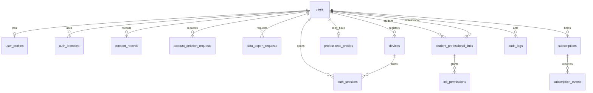
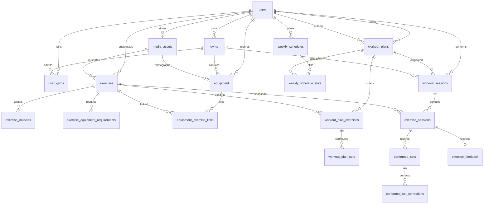
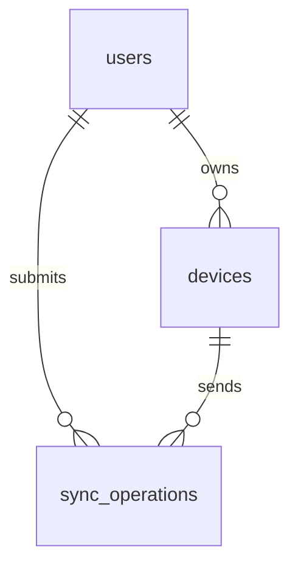

# Modelo de dados — MeuTreino+ 0.1

A fonte executável é `apps/api/prisma/schema.prisma` e a migração `apps/api/prisma/migrations/20261020180000_init`. Identificadores são UUID. Instantes são `timestamptz` em UTC. Nomes de tabela e coluna são `snake_case`.

`CustomExercise` da lista conceitual não virou tabela. Um exercício personalizado é uma linha de `exercises` com `origin = user` e `owner_user_id` preenchido. O banco recusa a combinação inversa.

## Identidade, privacidade e acesso

`billing_retention_records` não tem chave estrangeira. O identificador da transação da loja pode permanecer depois que a conta deixa de existir.

## Treino

## Sincronização

`sync_operations` guarda o recibo da tentativa: tipo, entidade, chave de idempotência, hash e versão base. O conteúdo fica na entidade e no dispositivo.

## Separação entre plano e execução

`workout_plans`, `workout_plan_exercises` e `workout_plan_sets` descrevem a intenção. `workout_sessions`, `exercise_sessions` e `performed_sets` descrevem o que aconteceu.

A sessão copia `plan_name_snapshot`, o nome da academia e a revisão inteira em `plan_snapshot`. Cada exercício da sessão copia nome, descanso, academia e equipamento escolhidos naquele momento. Quando `workout_plan_id` está preenchido, `plan_version` é obrigatório e aponta para `workout_plan_revisions`. A sessão referencia o plano com `ON DELETE RESTRICT`. Alterar a ficha depois grava outra revisão e não reescreve `plan_snapshot` nem a revisão antiga. `planned_set_id` em `performed_sets` não tem chave estrangeira para `workout_plan_sets`, porque a ficha pode substituir as séries planejadas. Os identificadores da sessão, dos exercícios, das séries e do feedback nascem no dispositivo.

`duration_seconds` é o tempo em que o treino esteve em andamento. `elapsed_seconds` é o tempo de parede, incluindo pausas. O índice parcial `workout_sessions_one_open_per_user` permite no máximo uma sessão `in_progress` ou `paused` por usuário. Uma sessão `completed` ou `aborted` exige `locked_at`, `ended_at` e `duration_seconds`. A função `protect_locked_workout_session` congela a fotografia, a versão da ficha e o início mesmo antes do travamento. Depois de `locked_at`, também congela status, horários, duração e notas. O gatilho `exercise_sessions_protect_locked_parent` impede alterar ou apagar exercícios de uma sessão já travada. Uma série que chega depois do travamento ainda pode ser inserida, porque `performed_sets` é append-only; a sincronização marca o conflito `session_locked` em vez de descartar a série.

## Imutabilidade

Gatilhos `BEFORE UPDATE OR DELETE` recusam mutação em:

- `consent_records`
- `performed_sets`
- `performed_set_corrections`
- `subscription_events`
- `workout_plan_revisions`
- `session_time_events`

Um erro de série vira uma nova linha em `performed_set_corrections`, com autor, motivo e o valor corrigido. A leitura do resultado efetivo usa a correção mais recente; a série original permanece.

`audit_logs` só aceita desligar `actor_user_id` para nulo. Os demais campos não mudam e a linha não é apagada pela aplicação.

## Regras que o Prisma não expressa

A migração acrescenta:

- Extensão `citext` para e-mail.
- `users.locale = 'pt-BR'`.
- Um grupo muscular principal por exercício, índice parcial `exercise_muscles_one_primary`.
- Uma agenda ativa por usuário, índice parcial `weekly_schedules_one_active_per_user`.
- Dias ISO 1 a 7. O tipo do slot exige ficha, atividade aeróbica ou descanso, nunca uma combinação.
- Carga progressiva ou fixa, peso corporal sem quilagem, ou duração obrigatória quando o tipo é tempo. A carga digitada fica em `target_load` com `load_unit`; `target_load_kg` é a conversão de ida e pode ser nula junto com a carga digitada.
- Índice parcial `workout_plan_exercises_active_order_idx` para a ordem dos exercícios ativos. O índice único completo foi removido de propósito.
- Preferência de equipamento por academia em `workout_plan_exercise_equipment`. Arquivar o equipamento não apaga a ficha.
- Mídia até 15 MB, somente `image/jpeg`, `image/png` e `image/webp`.
- Foto de equipamento somente com `kind = equipment_photo`.
- Visual de exercício de sistema somente licenciado. Exercício do usuário não usa a biblioteca licenciada.
- Vínculo profissional ativo somente com consentimento e sem revogação. Aluno e profissional são pessoas diferentes.
- Período de assinatura com fim posterior ao início.

A maioria das chaves estrangeiras é `ON DELETE RESTRICT`. Cascata existe nos filhos de composição: músculos e requisitos do exercício, exercícios e séries da ficha, slots da agenda e o vínculo equipamento-exercício. `duplicated_from_id` e a foto usam `SET NULL`. A academia do equipamento é obrigatória e `RESTRICT`: arquivar a academia não apaga a máquina. A academia de uma sessão também é `RESTRICT`.

Os objetos de negócio ficam no schema `meutreino`. O histórico `_prisma_migrations` permanece em `public` porque o Prisma 7.10 não oferece outro schema de migração. O índice parcial `gyms_one_preferred_per_owner` garante uma academia preferencial ativa por usuário e não está expresso no `schema.prisma`.

## Exclusão de conta e retenção

O purge roda na hora do pedido autenticado. Não há janela de 30 dias. A transação desliga os gatilhos append-only e o gatilho que protege `exercise_sessions` de uma sessão travada, apaga os dados pessoais e os religa antes do commit. Sem desligar esse gatilho, a exclusão de uma conta com treino concluído falha e a transação inteira volta atrás. O detalhe operacional está em [ACCOUNT_LIFECYCLE.md](./ACCOUNT_LIFECYCLE.md).

Ordem do purge, respeitando `RESTRICT`:

1. Copiar identificadores de transação para `billing_retention_records`.
2. Gravar uma trilha minimizada de consentimento se a obrigação legal exigir prova, e então apagar `consent_records`.
3. Desligar `audit_logs.actor_user_id`.
4. Apagar feedback, correções, séries, exercícios da sessão, sessões, slots, agendas, séries da ficha, exercícios da ficha, fichas, vínculos de equipamento, equipamentos, academias do aluno, mídia, permissões, vínculos, dispositivos, operações de sincronização, sessões de autenticação, identidades, perfil, pedidos de exportação e o pedido de exclusão.
5. Apagar eventos e assinaturas já copiados para retenção.
6. Marcar o usuário como `deleted`, limpar e-mail, hash de senha e nome, e preencher `deleted_at`. Exercícios de sistema não são tocados.

Dados compartilhados com profissional deixam de ser legíveis quando o vínculo é revogado ou quando a conta é apagada. O profissional não fica com cópia própria das sessões do aluno. A autoria em fichas de outros alunos continua válida enquanto essas fichas existirem.

Retenção em vigor:

| Dado                               | Prazo depois do purge    | Forma                                                        |
| ---------------------------------- | ------------------------ | ------------------------------------------------------------ |
| Identificador de transação da loja | 5 anos                   | `billing_retention_records`, sem e-mail                      |
| Auditoria de domínio               | enquanto a linha existir | ator desligado; a linha não é apagada                        |
| Evento de segurança                | enquanto a linha existir | `user_id` nulo; o evento final guarda o hash do UUID interno |
| Exportação pronta                  | 7 dias                   | arquivo apagado no purge e também ao expirar                 |
| Consentimento                      | não retido               | apagado com a conta; prova posterior ainda não existe        |

Fotografias de perfil saem do disco no mesmo purge. O bucket externo ainda não foi escolhido.
